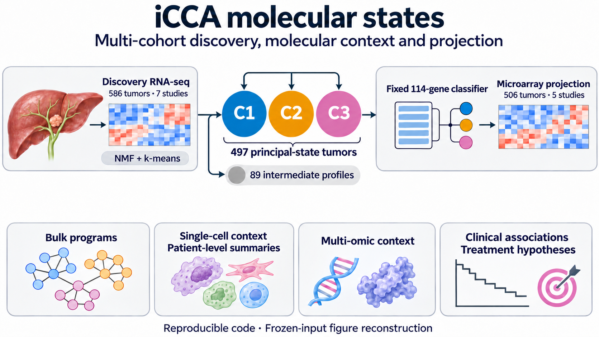

# iCCA molecular subtyping

[](LICENSE)



Selected upstream analysis implementations, notebooks, staged figure inputs and R plotting code for a multi-cohort study of intrahepatic cholangiocarcinoma (iCCA). The conceptual overview above and its [generation prompt](assets/project_overview_prompt.txt) are preserved unchanged from the previous public version. The overview summarizes the study; it is not quantitative evidence.

**Preparation snapshot: `v2026.11.23-preparation`.** This snapshot fixes the current code baseline for manuscript preparation. It does not designate a completed manuscript or a final scientific release. See [scope and checks](docs/PUBLICATION_READINESS.md) and [freeze notes](docs/FREEZE_20261123.md).

## Study scope

- Discovery comprises 586 RNA-seq samples: 497 principal-state samples (C1/C2/C3: 112/223/162) and 89 intermediate profiles. C1-Metabolic and C3-Proliferative are bulk-derived working descriptions; C2 remains C2.
- Bulk programs, multi-omics comparisons and patient-level clinical analyses characterize the subtypes. Observed pathology and inferred duct type retain separate denominators.
- The 114-gene consensus SVM is the primary classifier. Internal nested cross-validation and leave-one-study-out results estimate reproducibility of the operational labels. External cohorts are projections without independent subtype ground truth. The fixed 17-gene development candidate remains exploratory; performance of the adaptive compact-selection procedure is not an independent evaluation of that fixed list.
- Current single-cell localization uses 34,227 cells from 17 patients in two cohorts. Malignant identity remains unresolved, and malignant-program/TME association is not estimable with the currently qualified patients. GSE189903 remains source-review only.
- Drug prediction, TIDE, DepMap and the small PRISM comparison generate hypotheses; they do not establish clinical response or subtype-specific drug efficacy.

## Generate the main figure drafts

Run from the repository root with R and the plotting dependencies installed:

```bash
git clone https://github.com/yelu61/iCCA-molecular-subtyping.git
cd iCCA-molecular-subtyping
git checkout v2026.11.23-preparation
Rscript environment/install_packages.R
Rscript figures/run_all_figures.R
```

The six scripts use the 72 staged files under `figures/data/` and the governed colour dictionaries in `data/`. They produce individual panels and six composite PDF/PNG pairs under `figures/outputs/figure1` through `figure6`. Generated outputs are ignored by Git. The composite export is 180 × 270 mm with a 300 dpi PNG preview. Composite PDFs embed raster panels; individual PDFs are also generated. Known spacing/label issues and final journal layout acceptance remain documented in the snapshot checks.

For an individual draft:

```bash
Rscript figures/plot_figure1.R
# Optional explicit input/output locations:
Rscript figures/plot_figure1.R --data-dir figures/data/figure1 --out-dir figures/outputs/figure1
```

The interactive entry is [pipelines/8-visualization.ipynb](pipelines/8-visualization.ipynb). It locates the repository from its root or the notebook directory and uses `ICCA_R_HOME`, `R_HOME` or R on `PATH`. See [environment notes](environment/README.md) for the tested runtime and installation limits.

## Reproduce the analysis and selected main/supplementary panels

The previous public analysis implementation is retained in full. Its source files and required code dependencies are indexed in [IMPLEMENTATION_MANIFEST.csv](IMPLEMENTATION_MANIFEST.csv), with 24 analysis entries in [config/analysis_stages.json](config/analysis_stages.json). The original frozen-input drawing route and supplementary-panel support remain available alongside the six standalone draft scripts.

```bash
python3 run.py analysis --list
python3 run.py analysis --stage classifier114 --project-root /path/to/independent_project
```

The second command stages the selected source and prints its execution command. Supply the [documented upstream inputs](docs/upstream_external_interfaces.csv), then add `--execute` to run that analysis. Full upstream re-execution has not been claimed for this preparation snapshot.

The original selected-panel workflow uses the larger frozen input bundle:

```bash
python3 run.py verify --data-root /path/to/data_bundle
python3 run.py figures --data-root /path/to/data_bundle --output /path/to/new_output
python3 check_results.py --run-dir /path/to/new_output --data-root /path/to/data_bundle
```

[notebooks/Reproduce.ipynb](notebooks/Reproduce.ipynb) provides the same workflow. The companion archive `iCCA_frozen_inputs_20261104_v2.zip` is 474,136,575 bytes, SHA256 `0e7182c4a0b30c3cc907395096157324481de1555d78faf4168b1d66785ca762`; it unpacks to `data_bundle/`. Its public deposit is pending. The 756 required input identities are in `config/input_manifest.json`. The archive and raw inputs are not committed to Git.

## Repository contents

| Path | Role |
|---|---|
| `_implementation/`, `IMPLEMENTATION_MANIFEST.csv` | Preserved upstream analysis owners, code dependencies, drawing adapters and final-panel drivers |
| `run.py`, `check_results.py`, `config/`, `notebooks/` | Preserved analysis entry catalog and full selected-panel reproduction route |
| `figures/plot_figure*.R`, `figures/run_all_figures.R` | Standalone redraw from staged analysis results |
| `figures/data/` | Inputs required by these six drafts; [file identities](docs/INPUT_FILES.csv) |
| `data/` | Governed palettes and a four-column discovery assignment extract |
| `pipelines/` | Nine stage notebooks; [execution roles and external requirements](docs/NOTEBOOK_STATUS.md) |
| `assets/` | Preserved conceptual overview and original generation prompt |
| `environment/` | Installation declarations and recorded package inventories |
| `docs/` | Current scope, checks, terminology and historical provenance records |
| `tests/` | Regression checks for the public notebook plotting entry |

The `pipelines/` notebooks document the maintained research workflow; Steps 0–7 require project inputs and use project-relative paths. The portable analysis staging route is `run.py analysis`, backed by `_implementation/project/`. Preserved CLI-fronted notebooks within that tree and the current research notebooks in `pipelines/` have distinct roles. Neither retaining code nor redrawing frozen results establishes a fresh raw-input-to-manuscript run.

The 2026-11-12 verification remains versioned evidence for the unchanged original selected-panel route. Its counts must not be applied to the separate six-script draft entry.

The public selection excludes the full research workspace, manuscript drafts, slide history, raw data, large object caches and generated outputs. The local canonical subtype table is unchanged. The public `data/subtype_master_table.csv` retains only `Sample`, `Study`, `FinalSubtype` and `SubtypeClass`; it is not the complete patient covariate table. See [data dictionary](docs/DATA_DICTIONARY.md).

## Verification and citation

```bash
python3 -B -m unittest discover -s tests -v
```

The snapshot's execution scope and remaining limitations are documented in [PUBLICATION_READINESS.md](docs/PUBLICATION_READINESS.md). The retained [panel map](docs/final_panel_manifest.csv), [source lineage](docs/SOURCE_LINEAGE_20261110.csv) and [producer-review limits](docs/PRODUCER_REVIEW_LIMITS.md) retain 19 historical source-version gaps and four original writer-event gaps. The dated 2026-11-12 execution record is under [docs/history/20261112](docs/history/20261112/).

Code is distributed under the [MIT License](LICENSE). For now, cite the repository URL and version tag. Real software-author metadata and a persistent archival identifier remain to be completed in [CITATION.cff.template](CITATION.cff.template); no published manuscript reference or DOI is asserted.
